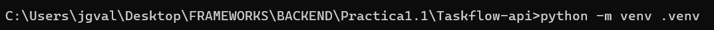
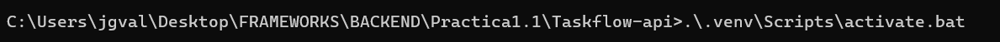
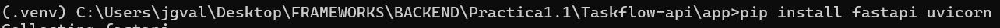
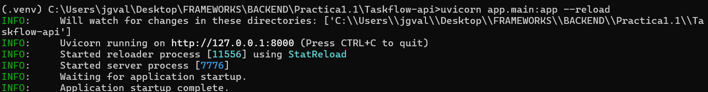
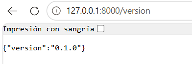
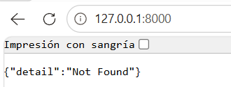

# Práctica 1.1 – Taskflow API (FastAPI)

## 1. Crear el entorno virtual

Se crea el entorno virtual `.venv` en la carpeta `Taskflow-api` para aislar las dependencias del proyecto del Python global.

```bash
python -m venv .venv
```



## 2. Activar el entorno virtual

Se activa el entorno en Windows (CMD). Si funciona, el prompt muestra el prefijo `(.venv)`, lo que indica que `python` y `pip` apuntan ya al entorno virtual.

```bat
.\.venv\Scripts\activate.bat
```



## 3. Instalar las dependencias

Se instalan FastAPI (el framework de la API) y Uvicorn (el servidor ASGI que la ejecuta), junto con sus dependencias como Starlette y Pydantic.

```bash
pip install fastapi uvicorn
```



## 4. Guardar las dependencias

Se vuelcan las versiones exactas de los paquetes instalados a `requirements.txt`. Con ese archivo cualquiera puede recrear el entorno con `pip install -r requirements.txt`.

```bash
pip freeze > requirements.txt
```


## 5. Arrancar el servidor

Se lanza la aplicación definida en `app/main.py` (objeto `app`). El parámetro `--reload` reinicia el servidor al detectar cambios en el código.

```bash
uvicorn app.main:app --reload
```

La salida confirma que:

- Uvicorn escucha en `http://127.0.0.1:8000`.
- Se vigila el directorio del proyecto con StatReload.
- Se iniciaron el proceso recargador y el proceso del servidor.
- `Application startup complete` indica que la aplicación arrancó bien.



## 6. Probar el endpoint /version

Al abrir `http://127.0.0.1:8000/version` en el navegador, la API responde con su versión. Esto confirma que el servidor y la ruta funcionan.

```json
{"version":"0.1.0"}
```



## 7. Ruta raíz /

Al abrir `http://127.0.0.1:8000` aparece un error 404. Es el comportamiento esperado: aún no hay ninguna ruta definida para `/`, y no indica un fallo de la instalación. La documentación automática de FastAPI está disponible en `/docs`.

```json
{"detail":"Not Found"}
```


